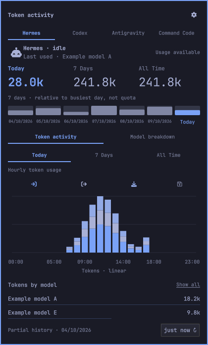
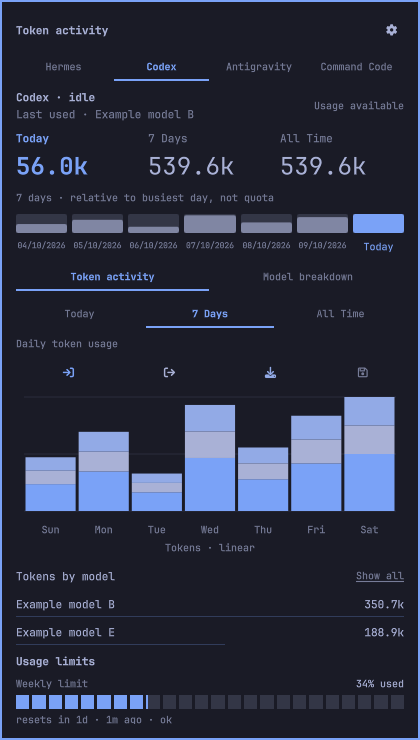

# AI Usage — Token activity for Omarchy

A native Omarchy/Quickshell bar widget with a local Python collector and durable SQLite token history. Shows Today, 7 Days and All Time, model breakdowns, and optional genuine provider quota windows. Unknown readings remain unavailable rather than fabricated zeroes.

## Screenshots

These are captures of the actual QML interface in an isolated preview session,
using **synthetic demonstration data**. Example models, token totals and quota
percentages are not readings from a real account. No personal usage, desktop
content or credentials are included.

<table>
<tr>
<td></td>
<td></td>
</tr>
<tr><td><strong>Today:</strong> hourly token activity and model totals.</td><td><strong>7 Days:</strong> daily token activity and the optional provider-limit display.</td></tr>
</table>

## How it works

1. **Open the panel:** click the AI icon in the bar. Agent tabs list detected
   executables, not merely leftover history directories.
2. **Choose an agent and range:** select a tool, then Today, 7 Days or All Time.
   The three totals remain visible; the chart follows the selected range.
3. **Inspect usage:** switch between Token activity and Model breakdown. Hover
   chart bars or model rows for detail; Show all expands the ranked model list.
4. **Read limits separately:** Usage limits show genuine provider windows only
   after explicit remote-quota opt-in. Missing readings say unavailable; local
   token history is never converted into a subscription percentage. The sample
   quota above illustrates the display only.
5. **Configure and refresh:** use the gear for the default agent, IANA timezone,
   personal token budget, reduced motion and source-path overrides. Refresh
   requests reconciliation through the existing collector, not a second writer.

## Requirements

- Omarchy Quattro (manifest schema v1; developed against Omarchy 4.0.4).
- Linux, Python **3.14+** with the standard library (DSH compressed logs use `compression.zstd`), systemd user services.
- Supported agent executables on the collector's PATH and readable local usage sources. Node.js is needed only for UI tests.
- Optional quota readers require the relevant signed-in native CLI or Command Code account. No agent or driver is installed automatically.

## Install

Review the repository before enabling it: Omarchy plugins execute unsandboxed as your user.

```sh
omarchy plugin add https://github.com/cynricantao/omarchy-ai-usage.git
python3 ~/.config/omarchy/plugins/cynricantao.ai-usage/collector/install.py install --activate
omarchy plugin enable cynricantao.ai-usage --section right
```

Omarchy only clones the plugin; it does not run the collector setup. The explicit setup command installs a local launcher and user service. It does not edit your bar layout, Hermes configuration, model defaults or credentials. Without `--activate`, setup writes the launcher/unit but does not enable or start the service. Existing conflicting files are refused; consult `install.py --help` before opting into replacement.

This widget has its own IPC identity. If you want it instead of the stock Agents widget, disable `omarchy.agents` yourself; leaving both enabled does not share the same IPC handler. Missing collector/snapshot is an unavailable-data state.

## Privacy and optional remote quotas

Local collection retains allowlisted token counts, model/provider labels, native session identifiers, profile/source identity, timestamps and coverage diagnostics. It does **not** persist prompts, responses, tool output or credential values. Reading a JSONL source may temporarily parse a full record before selecting usage fields. The ledger, exports, source overrides and snapshots are still private metadata: do not upload them or share a live dashboard screenshot without review.

State lives outside this checkout under `$XDG_DATA_HOME/token-activity` (default `~/.local/share/token-activity`); settings under `$XDG_CONFIG_HOME/token-activity`. Generated state is owner-private. Symlinked or permissive storage is refused rather than silently repaired. Uninstall preserves history.

**Remote quotas default to off.** Local token totals do not prove subscription allowances. If you explicitly consent to authenticated quota queries:

```sh
token-activity configure '{"remote_quotas":true}'
```

Codex uses native app-server account-read methods; Antigravity uses a native zero-turn `/usage` export. Those clients own authentication and may maintain their own runtime files. Command Code reads an existing `COMMAND_CODE_API_KEY` or `~/.commandcode/auth.json` into memory, then makes fixed-origin HTTPS GETs to `https://api.commandcode.ai/alpha/whoami` and `/alpha/billing/credits`. It rejects redirects, custom origins and proxies, suppresses raw response/error output, and retains only quota metadata. No model prompts, purchases or billing changes are requested. Disable further quota queries with `remote_quotas:false` and restart the collector to cancel pending work; existing quota metadata is retained and ages normally.

See [SECURITY.md](SECURITY.md), [collector/ADAPTERS.md](collector/ADAPTERS.md), and [collector/CONTRACT.md](collector/CONTRACT.md).

## Supported sources and limits

Hermes SQLite usage, Codex and Claude Code JSONL, Antigravity native generation metadata, OpenCode's supported v1 SQLite schema, Command Code v3 JSONL and DSH v4 logs have synthetic regression coverage. Source schemas can change; unsupported formats fail closed with incomplete coverage. A leftover history directory does not imply the agent executable is installed.

Historical multi-request cumulative records have unknown timing and stay in All Time rather than invented daily buckets. Retries, revisions and cumulative observations use stable identities; provider quotas remain separate from local token totals. No combined cross-tool grand total hides ambiguous overlaps. Shared Antigravity budgets stay shared rather than being misrepresented as individual model allowances.

The public installer uses read-only polling; it does not install the optional Hermes hook observer. `collector/observer.py` is included as tested integration code, not automatically enabled. Polling cannot guarantee capture of a request deleted before observation. UTC is the neutral default; configure an IANA timezone for local calendar charts.

```sh
token-activity configure '{"timezone":"UTC","daily_budget":null,"reduced_motion":true}'
token-activity status
token-activity rescan
token-activity backup
# Sensitive local metadata; review before sharing:
token-activity export > ~/token-activity-usage.jsonl
omarchy-shell cynricantao.ai-usage open
omarchy-shell cynricantao.ai-usage close
```

## Update and remove

```sh
omarchy plugin update cynricantao.ai-usage
# Stop the service before removing its source checkout:
python3 ~/.config/omarchy/plugins/cynricantao.ai-usage/collector/install.py uninstall
omarchy plugin remove cynricantao.ai-usage
```

After an update, rerun collector setup if its generated launcher/unit changed, following any explicit replacement instructions. No uninstall command deletes the ledger, backups or settings. Do not overwrite a live SQLite database without its WAL or a consistent online backup.

## Tests

```sh
cd collector
python3 -W error::ResourceWarning -m unittest discover -p 'test_*.py' -v
cd ..
node --test tests/*.test.cjs
omarchy plugin validate .
```

Tests use synthetic sources and isolated homes, not real credentials or paid model calls. They do not establish live provider authentication or full QML rendering acceptance. `tests/validate.py` optionally runs local Qt static analysis; generated lint reports must never be committed.

## License

MIT for the plugin/collector code, with retained Omarchy upstream copyright and permission notice in [THIRD_PARTY_NOTICES.md](THIRD_PARTY_NOTICES.md). Provider names are descriptive trademarks, not endorsements. No provider logos or personal dashboard screenshots are bundled.
